# Codyssey Development Workstation (Linux)

Windows WSL Ubuntu에서 터미널, Linux 권한, Docker, Git/GitHub 실습. 실행 명령과 결과는 각 항목의 로그·화면에 기록.

## 수행 체크리스트

- [x] WSL Ubuntu 작업 환경 확인
- [x] 터미널 기본 조작 및 파일 관리
- [x] Linux 파일·디렉터리 권한 변경
- [x] Docker 설치 점검 및 운영 명령
- [x] hello-world / Ubuntu 컨테이너
- [x] Dockerfile 작성·이미지 빌드·웹 서버 실행
- [x] 포트 매핑 및 브라우저 접속
- [x] 바인드 마운트 변경 반영
- [x] Docker 볼륨 데이터 유지
- [x] Git 설정·GitHub Push·VS Code GitHub 로그인
- [x] 오류 해결 2건

## 1. 환경 및 실행

| 항목 | 실습 환경 |
|---|---|
| OS / 터미널 | Windows WSL / Ubuntu 26.04.1 LTS / Bash |
| 편집기 | VS Code (WSL: Ubuntu) |
| Docker | Docker Desktop / Docker 29.9.2 / Linux 컨테이너 |
| Git | Git 2.53.0 / `main` |

**웹 서버 실행** — Docker Desktop 실행 후 WSL Ubuntu 터미널에서 입력.

```bash
git clone https://github.com/hyeonla906/codyssey-workstation-linux.git
cd codyssey-workstation-linux
docker build -t codyssey-linux-web:v2 .
docker run -d --name codyssey-linux-web -p 8080:80 codyssey-linux-web:v2
curl http://localhost:8080
```

**결과:** `http://localhost:8080`에서 HTML 응답 확인.

**연결:** PC `8080` → 컨테이너 `80` / 바인드 마운트는 PC `8081` → 컨테이너 `80`.

**참고:** 위 명령은 새 환경에서 실행하는 기준. 동일한 이름의 컨테이너가 이미 있거나 8080 포트를 사용 중이라면 기존 실행 상태를 먼저 확인해야 함.

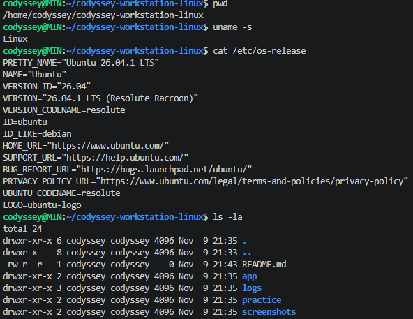

[환경 점검 기록](logs/verified/00-setup.txt)

## 2. CLI 파일 관리

**실행:** 파일 생성 → 내용 확인 → 복사 → 이름 변경 → 이동 → 삭제.

```bash
mkdir -p practice/lesson1
cd practice/lesson1
echo "Hello Codyssey" > hello.txt
cat hello.txt
cp hello.txt copy.txt
mv copy.txt renamed.txt
mkdir -p backup
mv renamed.txt backup/
ls backup/
rm backup/renamed.txt
ls backup/
cd ../..
```

**결과:** `Hello Codyssey` 출력, 이동·삭제 전후 파일 목록 확인. `pwd`, `ls` 등 기본 명령도 실행 기록에서 확인.

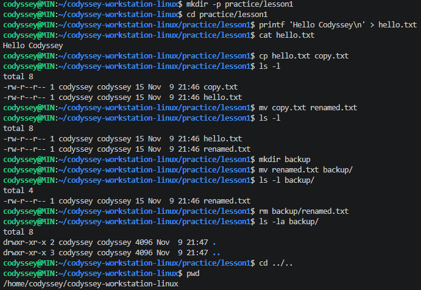

[터미널 전체 기록](logs/verified/01-terminal.txt)

## 3. Linux 파일·폴더 권한

**실행:** WSL Ubuntu에서 파일·폴더 권한 변경 후 `ls`로 확인.

```bash
mkdir -p practice/permissions
cd practice/permissions
touch test.txt
chmod 600 test.txt
ls -l test.txt
chmod 644 test.txt
ls -l test.txt
mkdir -p testdir
chmod 700 testdir
ls -ld testdir
chmod 755 testdir
ls -ld testdir
cd ../..
```

**권한:** `r=4`, `w=2`, `x=1`. `755` = 소유자 `rwx`, 그룹·다른 사용자 `r-x`.

**결과:** 파일 `600 → 644`, 폴더 `700 → 755` (`drwxr-xr-x`).

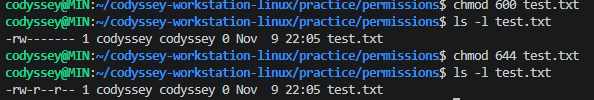

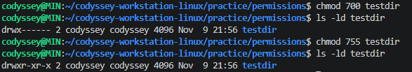

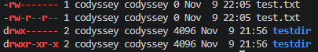

[권한 실행 기록](logs/verified/02-permissions.txt)

## 4. Docker 기본 점검

```bash
docker --version
docker info
docker run hello-world
docker pull ubuntu
docker run -it --name codyssey-linux-ubuntu-practice ubuntu bash
docker images
docker ps -a
docker run -d --name codyssey-linux-ubuntu-running ubuntu sleep infinity
docker exec codyssey-linux-ubuntu-running echo Hello-from-exec
docker stop codyssey-linux-ubuntu-running
docker start codyssey-linux-ubuntu-running
docker logs codyssey-linux-ubuntu-running
docker stats --no-stream codyssey-linux-ubuntu-running
```

**확인:** Docker `29.9.2`, Server `OSType: linux`, `hello-world` 성공, 이미지·컨테이너 목록.

**차이:** 이미지 = 실행에 필요한 파일 묶음 / 컨테이너 = 이미지를 실행한 작업 공간.

**실행 방식:** `-it`는 터미널 연결, `-d`는 백그라운드 실행. `exec`는 실행 중인 컨테이너에 명령 전달. `stop` 후 `start`로 다시 실행 가능.

**참고:** Ubuntu 컨테이너 내부(`root@...:/#`)에서는 `exit`로 나온 후 WSL Ubuntu(`codyssey@MIN`)에서 Docker 명령을 실행.

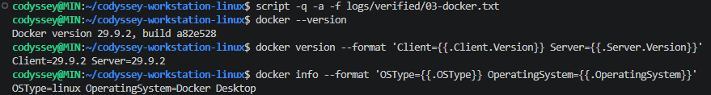

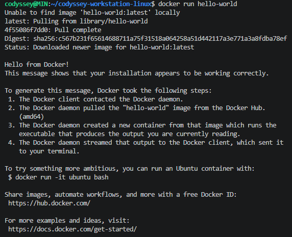

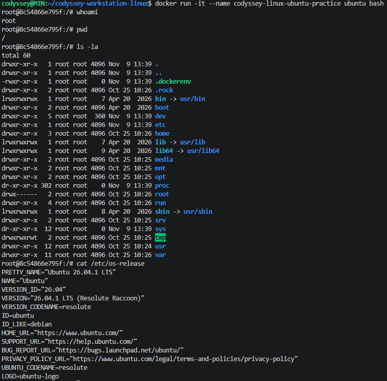

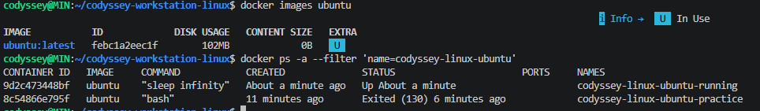

[Docker 점검 기록](logs/verified/03-docker.txt) · [Ubuntu 실행·Docker 운영 기록](logs/verified/04-containers.txt)

## 5. Dockerfile 및 웹 서버

**Dockerfile** — `nginx:alpine`을 기본 이미지로 선택. `app/index.html`을 NGINX 웹 폴더에 복사해 직접 만든 페이지 표시.

```dockerfile
FROM nginx:alpine
COPY app/index.html /usr/share/nginx/html/index.html
EXPOSE 80
```

`FROM` = 기본 이미지 / `COPY` = HTML 복사 / `EXPOSE` = 내부 사용 포트 표시.

```bash
docker build -t codyssey-linux-web:v2 .
docker run -d --name codyssey-linux-web -p 8080:80 codyssey-linux-web:v2
docker ps
docker logs codyssey-linux-web
curl http://localhost:8080
```

**결과:** 직접 작성한 Dockerfile로 이미지 빌드, 웹 서버 실행 및 HTML 응답 확인. 실습 중 웹페이지 내용을 수정해 이미지를 다시 빌드함.

**포트:** `-p 8080:80`으로 PC에서 접속 가능. `EXPOSE 80`만으로는 외부 포트가 연결되지 않음.

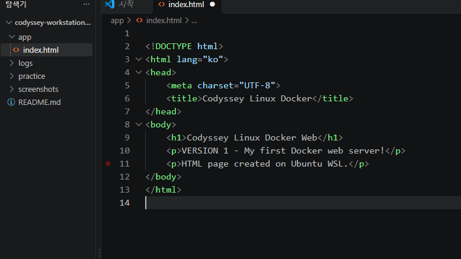

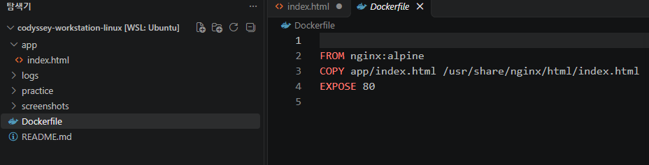

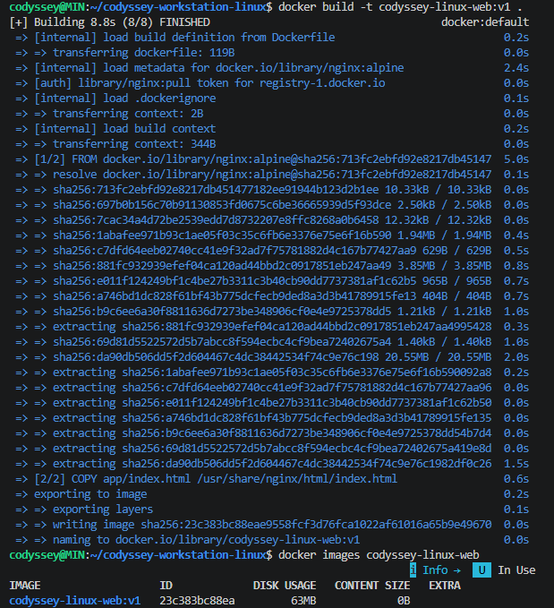

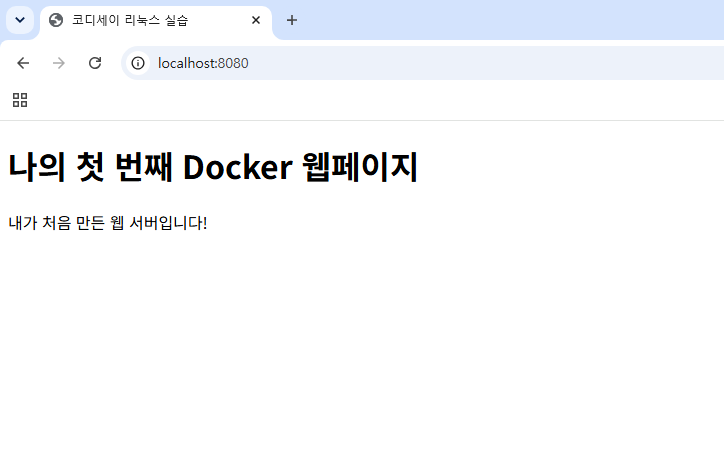

[HTML·Dockerfile 작성 기록](logs/verified/05-files.txt) · [웹 서버 실행 기록](logs/verified/06-webserver.txt)

## 6. 바인드 마운트

**실행:** WSL Ubuntu의 `app` 폴더를 컨테이너 웹 폴더에 연결.

```bash
docker run -d --name codyssey-linux-bind -p 8081:80 --mount "type=bind,source=$(pwd)/app,target=/usr/share/nginx/html,readonly" codyssey-linux-web:v2
curl http://localhost:8081
docker inspect codyssey-linux-bind --format '{{range .Mounts}}{{.Type}} {{.Source}} -> {{.Destination}} RW={{.RW}}{{end}}'
```

**결과:** `app/index.html` 수정 전·후 내용이 `localhost:8081` 웹페이지에 반영됨. 컨테이너 재빌드 없이 변경사항 확인.

**경로:** `$(pwd)/app`은 현재 WSL 폴더의 절대경로. `/usr/share/nginx/html`은 컨테이너 내부 경로. `readonly`는 컨테이너 내부 쓰기 제한.

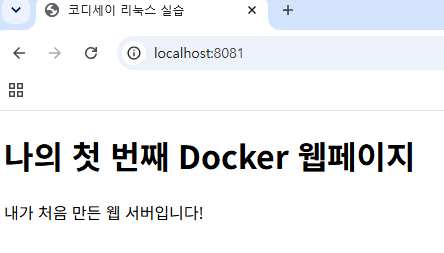

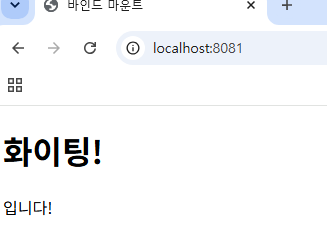

[바인드 마운트 기록](logs/verified/07-bind.txt)

## 7. Docker 볼륨: 컨테이너 삭제 전·후

```bash
docker volume create codyssey-data-linux
docker run -d --name volume-first-linux --mount type=volume,source=codyssey-data-linux,target=/data ubuntu sleep infinity
docker exec volume-first-linux sh -c 'echo SAVE-OK > /data/check.txt'
docker exec volume-first-linux cat /data/check.txt
docker stop volume-first-linux
docker rm volume-first-linux
docker run --rm --mount type=volume,source=codyssey-data-linux,target=/data ubuntu cat /data/check.txt
docker volume inspect codyssey-data-linux
```

**결과:** `volume-first-linux` 삭제 후 새 컨테이너에서 `SAVE-OK` 재출력. 볼륨 `codyssey-data-linux` 유지.

**차이:** 바인드 마운트는 WSL 폴더를 직접 연결 / 볼륨은 Docker가 데이터를 별도로 관리.

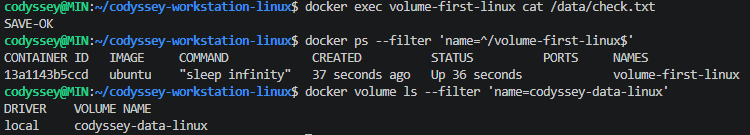

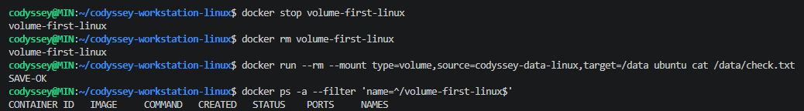

[볼륨 실행 기록](logs/verified/08-volume.txt)

## 8. Git / GitHub

```bash
git status
git branch --show-current
git config --get user.name
git config --get user.email >/dev/null && echo "Git 이메일 설정 확인 완료"
git config --get init.defaultBranch
git log -1 --oneline
git remote -v
git push origin main
```

**확인:** `main` 브랜치, Git 작성자 설정, 첫 커밋 및 추가 커밋, `origin` 원격 주소, GitHub 업로드.

**구분:** Git = 로컬에서 변경 이력 관리 / GitHub = 원격 저장소. `git add` = 변경 파일 선택 / `git commit` = 로컬 기록 / `git push` = GitHub 반영.

**추가 확인:** VS Code GitHub 계정 `hyeonla906` 로그인. 새 Git 저장소의 기본 브랜치 `main` 설정.

**원격 저장소:** [hyeonla906/codyssey-workstation-linux](https://github.com/hyeonla906/codyssey-workstation-linux)

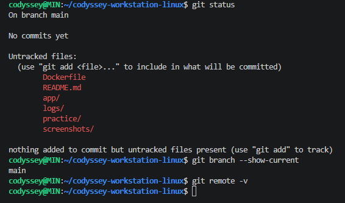

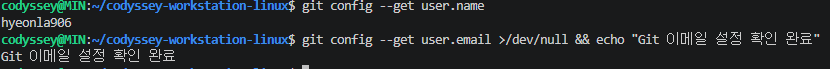

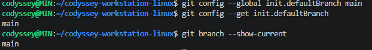

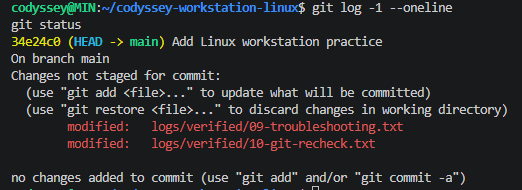

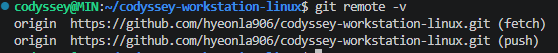

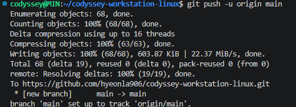

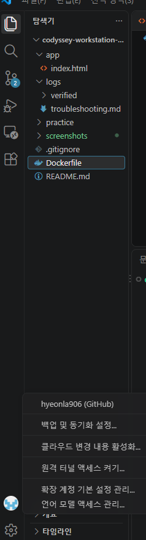

[Git 실행·Push 기록](logs/verified/10-git-recheck.txt)

## 9. 오류 해결

| 발생 | 원인 | 확인·수정 |
|---|---|---|
| `bash: docker: command not found` | Ubuntu 컨테이너 안에서 Docker 명령을 실행 | `exit`로 WSL Ubuntu에 돌아온 뒤 `docker images ubuntu` 실행 |
| `No such file or directory` | `index.html`을 `indx.html`로 잘못 입력 | `ls app`으로 파일명 확인 → `cat app/index.html` |

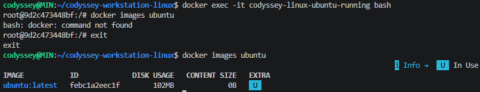

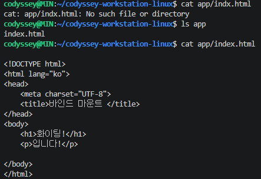

[오류 해결 상세 기록](logs/troubleshooting.md) · [오류 재현·확인 기록](logs/verified/09-troubleshooting.txt)

## 파일 구성

```text
Dockerfile                NGINX 웹 서버 이미지 설정
app/index.html            웹페이지
practice/                 CLI·권한 실습 파일
logs/verified/            실행 기록
logs/troubleshooting.md   오류 해결 2건
screenshots/              실습 증거 사진
.gitignore                Git 제외 파일 설정
README.md                 실습 요약
```
